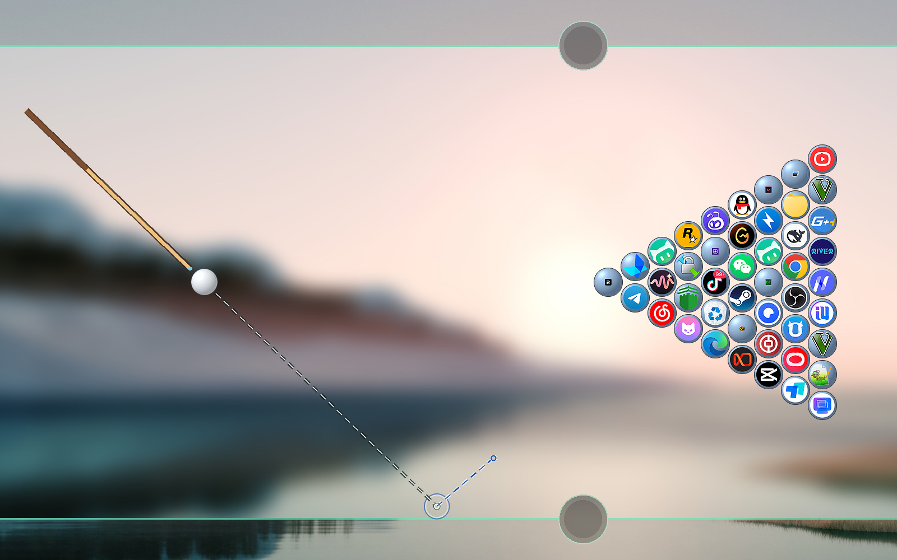

# DeskPools · 桌面图标台球

**把电脑桌面上的软件、文件夹与文件图标，变成一局真正能玩的台球。**

鼠标瞄准，按住左键蓄力，松手出杆。熟悉的图标会滚动、碰撞、落袋；游戏中的运动不会移动或删除原文件。支持 Windows，提供 Apple 芯片和 Intel Mac 测试版。

[官网](https://deskpools.com/) · [下载安装](https://deskpools.com/#downloads) · [问题反馈](https://github.com/LeiLeiQAQ/deskpools/issues) · [MIT 许可证](LICENSE)



> 截图为 Windows 版实拍。Mac 为测试版，不宣称与 Windows 功能完全一致。

## 这不是一张台球壁纸

- **图标就是球**：读取真实桌面项目的图标，绘制成清晰的圆形台球。
- **蓄力与瞄准**：按住左键控制力度，松开击球；支持辅助线与右键取消蓄力。
- **四种玩法**：自由练习、标准 15 球、90 秒挑战、每日挑战。
- **手感与外观**：击打、碰撞、落袋音效，音量调节与三款球杆皮肤。
- **随时暂停隐藏**：F1 暂停 / 恢复；Mac 部分键盘使用 fn + F1，也可通过菜单栏操作。
- **Windows 联网玩法**：分模式排行榜、成绩卡片、本机最近成绩与设置内手动检查更新。
- **完整开放源码**：Windows 客户端、macOS 客户端、官网、管理后台、排名服务和构建脚本均在本仓库。

## 下载与安装

**官方入口：[deskpools.com](https://deskpools.com/)**

下载地址保持为原夸克分享：[获取 Windows / Mac 安装文件](https://pan.quark.cn/s/a223a1da77fc)。网盘内按系统和处理器选择，不要把 GitHub 的“Download ZIP”源码当作安装包。

| 平台 | 选择什么 | 如何启动 |
| --- | --- | --- |
| Windows 10 / 11 x64 | Windows ZIP / EXE | ZIP 先解压，再运行其中的 EXE |
| Mac · Apple 芯片 | macOS版本 / arm64.dmg | 打开 DMG，将应用拖入 Applications，再从“应用程序”启动 |
| Mac · Intel | macOS版本 / x86_64.dmg | 同上，不要选择 arm64 文件 |

Mac 首次使用请允许读取桌面文件夹。两个 Mac 架构均已通过云端构建、镜像挂载及原生图标 / 绘制 / 击球 / 音效检查；真实桌面层级、多显示器、焦点和全局快捷键仍待人工实机验收。

当前 Windows 发布包尚未完成可信数字签名 / Microsoft 认证，Mac 测试包尚未完成 Developer ID 签名与 Apple 公证；安装包格式不代表已经获得系统信任认证。

## 平台功能

| 功能 | Windows | macOS 测试版 |
| --- | --- | --- |
| 桌面项目图标作为台球 | 支持 | 支持 Finder 桌面图标 |
| 蓄力、碰撞、落袋、辅助线 | 支持 | 支持 |
| 四种玩法、音效、球杆皮肤 | 支持 | 支持本机玩法 |
| 暂停隐藏 / 快捷键 | F1、任务栏、托盘 | F1 / fn + F1、菜单栏 |
| 全球排行榜 / 成绩卡片 | 支持 | 尚未移植 |
| 手动检查更新 | 支持 | 尚未移植 |

## 从源码运行 Windows

要求 Windows 10 / 11 x64、Explorer 桌面及 Python 3.11+（含 Tk）。推荐 Python 3.12。

```powershell
git clone https://github.com/LeiLeiQAQ/deskpools.git
cd deskpools
py -3.12 -m venv .venv
.\.venv\Scripts\python.exe -m pip install -r requirements.txt
.\run.cmd
```

在当前登录用户的桌面会话中运行。更多操作、桌面恢复与诊断说明见 [Windows 使用文档](docs/WINDOWS.md)。

### 打包 Windows EXE

安装 PowerShell 7 和 uv 后执行：

```powershell
pwsh -File build.ps1
```

已有构建环境可执行 `pwsh -File build.ps1 -SkipDeps`。输出为 `dist/DesktopIconBilliards-<version>-win-x64.exe` 及 SHA-256 文件。构建脚本会更新本地发布元数据，不会自动发布或修改生产官网。

### 运行回归测试

```powershell
.\.venv\Scripts\python.exe -m unittest discover -s tests -t . -v
```

## 构建 macOS DMG

在对应芯片的 Mac 上，从仓库根目录执行：

```sh
bash macos/build-macos.sh
```

生成 `.app`、DMG、校验文件及 ZIP。安装步骤与验证边界见 [Mac 文档](macos/README.md)。也可在 GitHub Actions 手动运行 **Build macOS app**，分别构建 Apple 芯片与 Intel 安装包；**Build Windows app** 提供 Windows 测试和打包。Actions 产物不等于经过人工桌面验收的正式发布。

## 官网、后台与排名服务

后端只使用 Python 标准库与 SQLite，Python 3.11+ 即可启动，无需安装 Windows 游戏依赖：

```sh
python -m website.server --host 127.0.0.1 --port 8070
```

- 本地官网：`http://127.0.0.1:8070/`。
- 本地管理：`http://127.0.0.1:8070/admin`，首次启动生成随机管理员令牌文件 `website/data/admin-token.txt`。
- 内置版本发布、下载点击统计、按模式排行榜及成绩管理。
- 公网部署使用 HTTPS 反向代理和独立持久化数据目录。后台不在官网导航展示，并设置 noindex；noindex 不是访问权限控制，管理 API 仍要求认证。
- 使用自建后端时，通过 `DIB_WEBSITE_URL`、`DIB_RANK_URL` 配置客户端地址。不要把测试成绩提交到官网生产榜单。

详见 [后端与部署文档](docs/UPDATE.md)、[排名协议](ranking_server/README.md)。生产数据库、令牌、密钥、本机调试文件及安装产物不属于公开源码。

## 代码导览

| 路径 | 内容 |
| --- | --- |
| `dib/`、`app.pyw` | Windows 客户端与共享物理、图像、玩法、音效代码 |
| `macos/` | AppKit / PyObjC 客户端与 DMG 构建 |
| `website/` | 官网、管理后台、版本发布和下载统计 |
| `ranking_server/` | 排名协议、成绩校验与 SQLite 存储 |
| `assets/` | 应用图标与音效 |
| `tests/`、`tools/` | 回归测试、资源工具、构建及部署辅助 |
| `.github/workflows/` | Windows / macOS 构建流程 |

## 隐私与网络

图标读取和游戏渲染在本机完成，不上传桌面截图、图标名称或文件内容。Windows 全球排名默认关闭，主动开启后提交设备哈希、回合用时、图标数、杆数与系统版本；服务端记录连接 IP，并在榜单显示 IP 与系统信息。下载统计记录入口点击量，不把点击数宣称为已安装人数。

## 开源与致谢

基于 [LXG / desktop-icon-billiards](https://github.com/liuxiaogang-com/desktop-icon-billiards) 二次开发，保留原项目 MIT 许可证与版权声明。DeskPools 在此基础上增加跨平台客户端、网站后台与玩法增强。

欢迎 [提交 Issue](https://github.com/LeiLeiQAQ/deskpools/issues) 与 Pull Request，见 [贡献指南](CONTRIBUTING.md)。源码使用 [MIT](LICENSE) 许可证；第三方依赖遵循各自许可证，桌面上第三方软件图标的商标权仍归原权利人。

