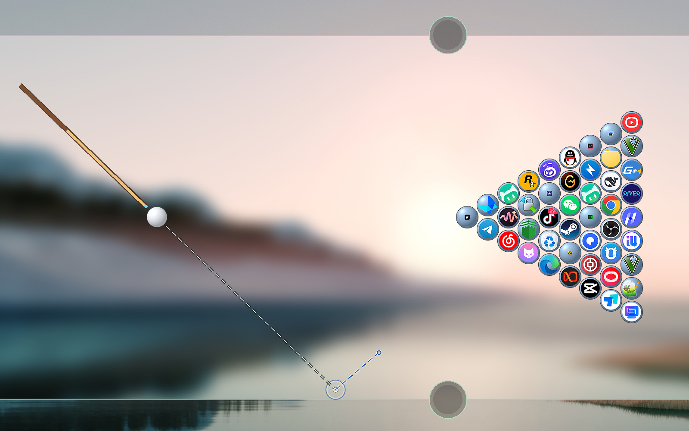
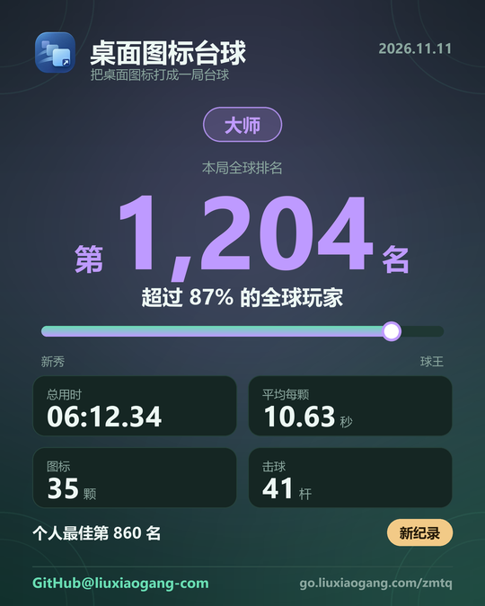
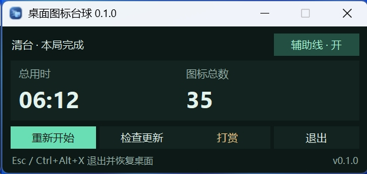

# 桌面图标台球 · Desktop Icon Billiards

**把 Windows 桌面图标摆成一局台球。** 在桌面上移动鼠标瞄准，按住左键蓄力，松手击球。图标保留自己的缩略图，会滚动、碰撞和入袋。退出后，桌面恢复原样。

Windows 10 / 11 x64 · 单文件 EXE · MIT

### 本地增强版 0.3.1

- 修正 Shell 图标读取时 COM 指针的引用环，确保图标资源在原读取线程的 COM 环境关闭前释放。
- 修正可见球缘与碰撞圆不一致的问题；新增右键取消蓄力与未完成局重开确认。
- F1、任务栏和托盘统一暂停恢复；设置内可改键、处理占用、调节音量、静音与切换球杆。
- 自由练习之外新增固定 15 球的标准排位、90 秒挑战、每日统一球阵挑战；竞技暂停继续计时。
- 真人按模式分榜，旧成绩和电脑对手分榜展示；本机保存最近十局，有联网局次的成绩断网后可重试。
- 增加界面和动画心跳检测；前台切换自动暂停、静音并隐藏游戏附属窗口。
- 构建同步生成版本说明、更新元数据与 SHA-256 校验文件。验收范围见 `docs/ACCEPTANCE-0.3.1.md`，上一版记录保留于 `docs/ACCEPTANCE-0.3.0.md`。

以下为保留的既有增强功能：

- 修复退出时布局日志被看门狗并发读取导致的拒绝访问，以及错误弹窗重入引发的连续报错；日志读写统一使用跨进程互斥锁，保存成功后才标记恢复完成。
- 新增独立落袋音效，图标球和白球落袋时播放；落袋声优先于碰撞声，采用异步播放。
- 官网、后台、排行榜与设置内手动检查更新默认接入 `https://deskpools.com`。
- 击球、球间碰撞和撞库播放短音效，按碰撞强度选择三档样本；异步播放并合并密集碰撞，避免重复截断声音。
- 程序图标恢复为首版透明背景的翡翠绿 8 号球和木质球杆，ICO 包含 16、20、24、32、40、48、64、96、128、256 像素共 10 档独立渲染资源。
- 应用图标 PNG 母版为 1024×1024，主工具栏同步显示该 8 号球标记；主界面采用深色台呢、翡翠绿和木质金色皮肤。
- 台面上的 Explorer 软件、文件和文件夹统一绘制成完整球体，图标嵌在球心并带有清晰的双层球缘。
- 从 Windows Shell 请求最高 6 倍尺寸的原始图源，并启用系统放大标志，再用 Lanczos 缩放到桌面球径，提升球心图标清晰度。
- 高分辨率图源只用于绘制，桌面实际球径单独保存，避免物理球尺寸和贴图尺寸混用造成二次模糊。
- 球心图标增加受控边缘锐化，球体旋转使用 Lanczos 重采样，减少运动和静止状态的软边。
- 按 `F1` 暂停并隐藏游戏、显示原桌面图标，主窗口最小化到任务栏；再次按 `F1` 恢复。
- 工具栏持续显示 `F1 暂停 / 恢复` 快捷键提示。
- 关闭台面后进入隐藏台面模式：六个洞口显示 Windows 原生回收站图标，工具条移开 1 秒自动收起为小眼睛，鼠标移到眼睛上恢复；按住 `Shift` 临时显示半透明球杆、辅助线和力度条。
- 合入上游 v0.2.0 的角袋入口、薄切碰撞、Explorer 桌面筛选、启动重试和拒绝访问诊断。
- 工具栏改为紧凑的无边框状态条；点击齿轮打开独立的迷你设置浮窗，操作按钮和快捷键集中在浮窗内，状态条和浮窗位置自动贴合桌面并可拖动。
- 新增顶部「排行榜」入口；成绩卡片恢复超过玩家百分比的可视化进度条。
- 轻点力度下限降低，满蓄力窗口延长到 1.35 秒；四角洞口采用连续轨迹判定，辅助线与实际入口保持一致。
- Shell 图标请求改用更大的原始图源与系统放大标志，改善部分电脑读取失败和小图标模糊。
- 本地构建产物为 `dist/DesktopIconBilliards-0.3.1-win-x64.exe`。



## 下载

增强版 v0.3.1 为免安装单文件 EXE，本地产物为 `dist/DesktopIconBilliards-0.3.1-win-x64.exe`。[官网](https://deskpools.com)当前已发布 v0.3.1，下载入口跳转至夸克网盘，后台可查看下载点击统计。上游原版仍可从 [GitHub](https://github.com/liuxiaogang-com/desktop-icon-billiards/releases) 或 [CNB 国内镜像](https://cnb.cool/liuxiaogang/desktop-icon-billiards/-/releases) 下载。

`desktop-icon-billiards` 的源码和发布附件在两个平台同步。[GitHub 仓库](https://github.com/liuxiaogang-com/desktop-icon-billiards) · [CNB 国内镜像仓库](https://cnb.cool/liuxiaogang/desktop-icon-billiards)

增强版官网为 [DeskPools 桌面图标台球](https://deskpools.com)。

## 玩法

1. 启动后等桌面图标摆好。移动鼠标选择白球的出球方向，**按住左键蓄力，松手击球**。按下的位置旁会显示「力度」进度条。
2. 用「**辅助线 · 开 / 关**」切换瞄准辅助。白线标记首次碰撞前的路线，蓝线表示白球碰球或碰库后的方向，绿线表示被撞图标的方向。路线会随力度变化，终点是预计的下一次碰撞、入袋或停球位置。辅助线带有描边，并会根据壁纸明暗自动换成深色或浅色。路线上还会画出白球接触瞬间的位置与目标碰撞圆，碰撞圆与可见球体使用相同直径；受击光圈是独立特效。
3. 主窗口显示本局用时、进球数和剩余图标数。白球入袋时会尝试自动摆回，如果没有合适的位置，可以点击台面空处摆球。白球入袋不计入进球数。
4. 清台后查看总用时和图标总数。点击「**重新开始**」重置本局，也可以在中途重开。
5. 右键取消蓄力；`Esc` 在蓄力时取消，其他时候暂停。点击「退出」或使用全局快捷键 `Ctrl+Alt+Shift+X` 恢复桌面并退出，快捷键可在设置中修改。

### 计时与全球排名

- 用时从**第一杆击出**算起，开球前瞄准不计时。自由练习暂停时停表，三种竞技玩法暂停期间继续计时；90 秒挑战到时结算，其余模式清台结算。
- 自由练习使用 **15～45 颗**图标球，标准排位、90 秒挑战和每日挑战固定 **15 颗**、2:1 台面。桌面图标不足时复制补足，图标过多时按快捷方式、程序、文件、文件夹优先级选择；复制球和未选中的图标都只影响游戏画面。
- 「全球排名」**默认关闭**，完成第一局后才邀请参与。开启后，标准排位、90 秒挑战和每日挑战分别上榜；自由练习只保存本机成绩。真人榜、电脑挑战和旧版成绩分开，真人名次与百分比不包含电脑。
- 标准排位与每日挑战按清台用时排序；90 秒挑战先比较进球数，再比较用时和杆数。每日挑战按 UTC+8 日期使用统一球阵与独立日榜。
- 本机保留最近十局。有联网确认局次的成绩，发送失败时会保存为待提交并重试，重启后仍保留；同一局最多记录一次，六小时后过期。完全离线且未取得服务端局次的成绩只保存在本机，停止参与排名会取消待提交记录。
- 结算后会弹出**成绩卡片**：按当前玩法显示成绩、用时、图标数、击球数和个人最佳；90 秒挑战显示进球数与进球率。开启排名并成功提交后，还可查看当前真人榜的名次和超过玩家比例。点「保存图片」会存成 1080×1350 的 PNG（在「图片」文件夹的 `DesktopIconBilliards` 里），点「复制图片」可直接粘贴到微信、QQ 或帖子里。点击「查看排行榜」可查看所选榜单前 50 条个人最佳成绩，自己的名次高亮并固定显示在底部。卡片只含成绩，不会出现你的桌面图标和文件名；没开启排名时仅显示本局成绩，并提示开启排名。



### 窗口与隐藏

- 主窗口只保留**无标题栏、无状态栏的迷你状态条**：显示图标、用时、进球、剩余数量和 F1 提示。点击右侧齿轮打开独立设置浮窗，浮窗内提供重新开始、辅助线、排名、台面、打开官网和退出；拖动左侧手柄或数据区域移动状态条，位置会自动保存。
- 工具栏和结算窗口只在桌面或游戏窗口前台时显示；切到其他软件会自动暂停、停止声音并隐藏附属窗口，回到桌面后恢复。按 `F1` 暂停并最小化到任务栏，再按一次或点击任务栏恢复；`Esc` 取消蓄力或暂停。点击「退出」或按 `Ctrl+Alt+Shift+X` 恢复桌面并退出；快捷键可修改，托盘也提供恢复和退出入口。
- **台面**开关进入隐藏台面模式：隐藏台面框和壁纸衬底，六个洞口显示原生回收站图标；工具条移开鼠标 1 秒后收起，原位置保留小眼睛，鼠标移上去即可恢复。按住 `Shift` 临时显示半透明球杆、辅助线和力度条。
- 图标入袋时会滑进球袋、旋转缩小并淡出，同时泛起一圈涟漪。
- 遇到无法击球、多显示器错位等问题，请把 `%TEMP%\DesktopIconBilliards` 下的 `diag.log` 和 `error.log` 一并反馈。



## 从源码运行

需要 Windows 10 / 11 x64、Explorer 桌面和 Python 3.11+（含 Tk）。下面用 [uv](https://docs.astral.sh/uv/) 安装 Python 3.12 和运行依赖。

```powershell
uv venv --managed-python --python 3.12 .venv
uv pip install --python .\.venv\Scripts\python.exe -r requirements.txt
.\run.cmd
```

环境准备好后，也可以双击 `run.cmd`。如果双击后没有窗口，从 PowerShell 运行 `.\.venv\Scripts\python.exe -X utf8 app.pyw` 查看错误。若访问 Explorer 时遇到「拒绝访问」，请在当前登录用户的普通桌面会话运行。使用 Microsoft Store 版 Python 创建过虚拟环境时，可移走旧的 `.venv` 后按上面的命令重建。

## 构建与测试

打包需要 PowerShell 7 和 uv。

```powershell
pwsh -File build.ps1
```

产物位于 `dist/DesktopIconBilliards-<version>-win-x64.exe`，可以直接运行。脚本会输出大小和 SHA-256，版本号取自 `dib/__init__.py`。已安装构建依赖时，可加 `-SkipDeps`。

脚本会将发布 EXE 文件的完整性标签设为 High，避免把从 High 完整性 Explorer 启动的进程压低到 Medium，导致桌面图标列表消息被 UIPI 拦截。EXE 使用 `asInvoker` 清单：普通用户从普通 Explorer 启动仍以普通用户权限运行，不会请求 UAC 提权；这里只修改发布文件标签，不改项目目录或系统临时目录权限。

```powershell
.\.venv\Scripts\python.exe -m unittest discover -s tests -t . -v
```

- [官网、后台与排行榜部署](UPDATE.md)
- [排行榜服务器部署](../ranking_server/README.md)
- [示例更新清单](../update.example.json)
- 顶部「设置」显示当前版本，点击「检查更新」即可读取统一后台发布的当前版本与说明，并通过浏览器下载安装包。仅手动检查，启动不轮询；后台地址沿用 `DIB_WEBSITE_URL`。
- 图标绘制逻辑位于 `dib/art.py` 的 `billiard_icon_art()`。运行 `.\.venv\Scripts\python.exe tools\gen_app_icon.py`，生成 `assets/desktop-icon-billiards.png`（1024×1024）和十种独立渲染尺寸的 Windows ICO。

## 桌面与隐私

游戏通过 Windows Shell 读取桌面图标的缩略图和布局，用独立的桌面图层绘制游戏画面。台面内的高斯模糊来自本地壁纸文件。游戏不截取桌面画面，也不采集音频。

主动开启「全球排名」后，游戏提交每局用时、图标数量、击球次数、当前 Windows 版本与构建号，以及用于区分电脑的设备哈希。官网、后台和软件内排行榜显示连接 IP 与系统版本；IP 由服务端从连接获取，成绩按电脑分别保留最佳记录，同一网络下多台电脑不会合并。不上传图标名称、桌面截图或文件信息。旧版参与设置会重新展示这项说明，确认后开始提交。设备凭据保存在 `%APPDATA%\DesktopIconBilliards\rank.json`。默认官网与排名服务统一指向 `https://deskpools.com`；需要调试本机后台时，运行 `tools/run_local_backend.ps1 -LaunchClient`，脚本会通过 `DIB_WEBSITE_URL` 和 `DIB_RANK_URL` 覆盖为本机地址。部署见 [统一后台说明](UPDATE.md)。

退出时会恢复桌面，独立看门狗会在进程异常退出，或界面/动画心跳持续失联时停止本次游戏并恢复桌面。运行记录位于 `%TEMP%\DesktopIconBilliards`。游戏期间若更改分辨率、DPI 或屏幕布局，本局会停止并恢复桌面。桌面图标需处于显示状态，同一时间只运行一个实例。

当前发布包没有可信数字签名，未完成 Microsoft 认证或全新 Windows 环境下的 SmartScreen 信誉验收；不承诺下载后不会出现 Windows 安全提示。实机验收范围和未测项目见 `docs/ACCEPTANCE-0.3.1.md`。

## 许可证

[MIT](../LICENSE)
